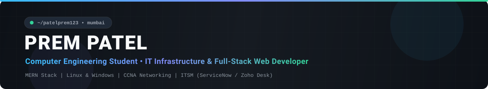

  

 

  

  
  
  

---

### 👨‍💻 About Me

- 🎓 Pursuing **B.E. in Computer Engineering** at *Universal College of Engineering, Mumbai* (2023 – 2027)
- 🛠️ Completing **IT Infrastructure & Technical Support Training** at *Jetking, Borivali* (incl. **CCNA** fundamentals)
- 💻 Independently built **4+ full-stack & systems projects** covering IT Asset Management, Offline LAN CBT Exams, IT Service Management (ITSM), and Developer Collaboration
- 🌱 Currently sharpening: **REST APIs, JWT Authentication, and CCNA Networking**
- 🤝 Looking for: **Internships in IT Support / Infrastructure or Full-Stack Web Development**

---

### 🛠️ Tech Stack & Skills

**Languages**

  
  
  
  

**Frontend & Backend**

  
  
  
  
  
  
  
  
  

**Databases & Tools**

  
  
  
  
  

**IT Infrastructure, Networking & ITSM**

  
  
  
  
  
  

---

### 📜 Certifications & Training

- 🖥️ **IT Infrastructure & Technical Support Training** — *Jetking, Borivali* *(In Progress; Expected July 2027)*
- 🌐 **CCNA (Cisco Certified Network Associate)** — *In Progress*
- 💻 **Full Stack Web Development** — *Skill Level Certification*
- 🤖 **CCC Professional with Artificial Intelligence**

---

### 🚀 Featured Projects

| Project | Description | Tech Stack |
| :--- | :--- | :--- |
| [**AssetTrack**](https://github.com/PatelPrem123/AssetTrack) | IT Asset & Hardware Inventory Platform with 128-bit QR tags, component swap ledger & Excel/PDF reports | `React` `Node.js` `Express` `MongoDB` `PDFKit` |
| [**ExamShield LAN**](https://github.com/PatelPrem123/ExamShield-LAN) | Air-gapped offline LAN CBT exam engine with proctoring, auto-save & SQLite WAL recovery | `Node.js` `Express` `SQLite` `WebSockets` `Electron` |
| [**HelpDesk Hub**](https://github.com/PatelPrem123/HelpDesk-Hub) | Enterprise IT Service Management (ITSM) platform with strict FSM ticket lifecycle & SLA tracking | `React` `Node.js` `Express` `MongoDB` `Socket.IO` |
| [**DevFlow**](https://github.com/PatelPrem123/DevFlown) | Agile developer collaboration workspace with Kanban boards, fractional indexing & GitHub API sync | `React` `Node.js` `Express` `MongoDB` `GitHub API` |

---

### 🏆 GitHub Trophies

  

---

### 📊 GitHub Stats & Activity

  
  

  

  

---

### 🐍 Contribution Snake

  <picture>
    <source media="(prefers-color-scheme: dark)" srcset="https://raw.githubusercontent.com/PatelPrem123/PatelPrem123/output/github-contribution-grid-snake-dark.svg" />
    <source media="(prefers-color-scheme: light)" srcset="https://raw.githubusercontent.com/PatelPrem123/PatelPrem123/output/github-contribution-grid-snake.svg" />
    
  </picture>

---

### 📫 Connect With Me

- 💼 **LinkedIn:** [linkedin.com/in/prem-patel-b011633a3](https://www.linkedin.com/in/prem-patel-b011633a3)
- 📧 **Email:** [19.prempatel@gmail.com](mailto:19.prempatel@gmail.com)
- 📍 **Location:** Mumbai, India
